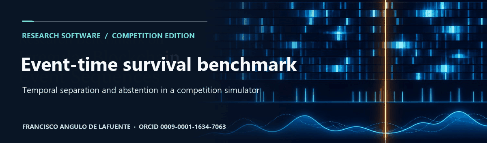
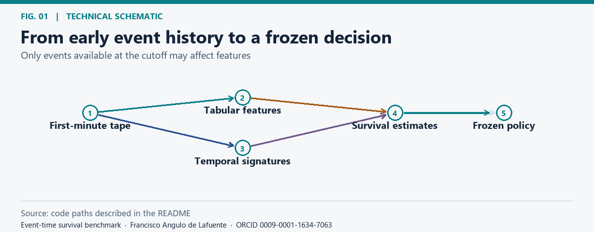
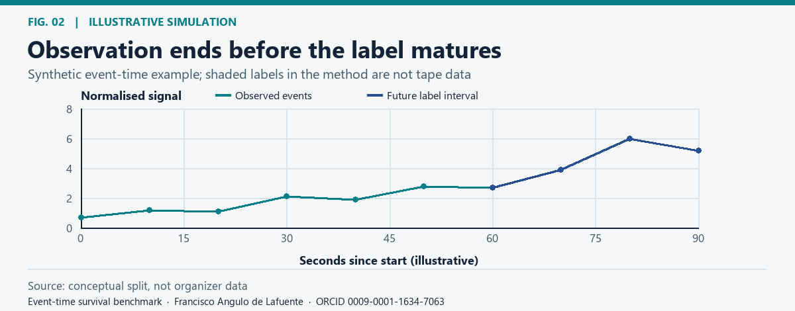
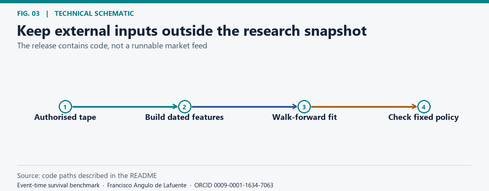
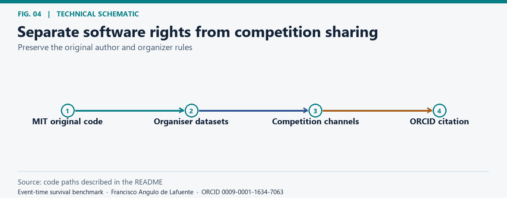

# 9 November2026: causal audit and source release

**The fixed candidate did not improve the control.** Both abstained on all 11 held-out
days: total idealised PnL0.0 each, paired bootstrap interval[0.0,0.0].
[Full methods, negative result and reproduction](research/2026-11-09/README.md) ·
[Selected plain-source notebook](research/2026-11-09/portable/memecoins-causal-control.ipynb).

This is a clean source snapshot; it excludes the private repository's Git history.
Its original 27 files and all figures are preserved, and the historical README begins
below unchanged. Its earlier validation description is superseded by the executed
causal audit; earlier private-visibility paragraphs are retained as dated history.
The selected control is an unproven baseline, not evidence of a winning strategy.
[Associated Kaggle source archive](https://www.kaggle.com/code/franciscoangulo/memecoins-causal-audit-20261109)
must be verified before this snapshot is published elsewhere.

**Historical src/solution.py trains at import time.** Do not import or run it as
the current entry. Use the selected portable notebook linked above. Its six code
cells completed on the owner Linux server in 662 seconds using four CPU cores,
about 3.1 GiB peak child RSS, and no GPU; organiser acceptance remains separate.

New research source: Apache-2.0, with full license and notices in research/2026-11-09.
Original project-authored root software keeps its MIT notices. The reservoir port
also retains its Apache-2.0 attribution and full license. Competition data and fitted models are not included.
[Delivery status](research/2026-11-09/DELIVERY_STATUS.json) distinguishes runtime,
publication, identity linking and actual organiser receipt.

---

# Event-time survival benchmark

**Research author:** [Francisco Angulo de Lafuente](https://orcid.org/0009-0001-1634-7063) · [Citation](CITATION.cff).

## Research scope

*From early event history to a frozen decision.* [Static figure](docs/figures/dataflow.png).

An original research implementation prepared for [Memecoins: Pump or Dump?](https://www.kaggle.com/competitions/memecoins-pump-or-dump). It uses events observed up to a decision time in an offline challenge simulation. No trades, financial recommendations or official score are produced by this repository.

## Temporal validation

*Observation ends before the label matures.* [Static figure](docs/figures/timing.png).

The original research code fits and calibrates on earlier days, applies a forward embargo, and scores later days. Two third-party public controls and the Kaggle sandbox are separate from this implementation. Local historical performance was unstable across seeds; no official submission or trading performance is inferred.

## Reproduce

*Keep external inputs outside the research snapshot.* [Static figure](docs/figures/reproduce.png).

The original single-file implementation is [src/solution.py](src/solution.py), with research modules [policy.py](src/policy.py) and [hrc.py](src/hrc.py). Use separately authorised competition inputs and the organiser's offline CPU environment. The code expects day-partitioned competition files; the tracked baseline contains no input tapes, entrant notebooks or submission files ([inventory](provenance-baseline.json), commit `2d6a994`). Attribution comments contain the author's public Kaggle and GitHub usernames.

<!-- author-background:start -->
## Author background

**Francisco Angulo de Lafuente**, independent AI researcher · [ORCID](https://orcid.org/0009-0001-1634-7063) · [arXiv](https://arxiv.org/a/angulodelafuente_f_1.html) · [Google Scholar](https://scholar.google.com/citations?user=6nOpJ9IAAAAJ) · [ResearchGate](https://www.researchgate.net/profile/Francisco-Angulo-Lafuente-3) · [Figshare](https://figshare.com/authors/Francisco_Angulo_de_Lafuente/22601234) · [Wikipedia](https://es.wikipedia.org/wiki/Francisco_Angulo_de_Lafuente)

Earlier research at ECOFA focused on biotechnology for clean energy and on second-generation biofuels obtained by microbiological processing of organic waste. Two Spanish patents document that work:

- **ES 2273594 B1**, *Process for obtaining fuels from organic waste*. Filed 5 September 2005, grant published 16 February 2008. [OEPM](https://www.oepm.es/pdf/ES/0000/000/02/27/35/ES-2273594_B1.pdf) · [Google Patents](https://patents.google.com/patent/ES2273594B1/en)
- **ES 2341194 B1**, *Method for obtaining paraffin by a biological process with microorganisms from organic matter, and its refining for use as fuel*. Filed 11 September 2007, grant published 26 April 2011. Also published as EP2196519 and WO2009034217. [OEPM](https://www.oepm.es/pdf/ES/0000/000/02/34/11/ES-2341194_B1.pdf) · [Google Patents](https://patents.google.com/patent/ES2341194B1/en)

These are historical publication and grant records under the inventor name Francisco Angulo Lafuente, and both have since lapsed. They are cited as evidence of a research trajectory and make no statement about current enforceability.
<!-- author-background:end -->

## License and scope

*Separate software rights from competition sharing.* [Static figure](docs/figures/rights.png).

Original project-authored software is MIT licensed within the scope in [LICENSE_SCOPE.md](LICENSE_SCOPE.md). Kaggle labels the competition data [Subject to Competition Rules](https://www.kaggle.com/competitions/memecoins-pump-or-dump/data); the [tracked baseline inventory](provenance-baseline.json) lists 24 paths and contains no competition data or submission files. Under the [official competition rules](https://www.kaggle.com/competitions/memecoins-pump-or-dump/rules), private code sharing outside Teams is prohibited. Public code must be shared on this competition's Kaggle discussion or notebooks under an OSI-approved license that does not restrict commercial use. This GitHub repository remains private during the active competition.

## Bibliography and proposed checks

- [Roberts et al. (2017), Cross-validation strategies for structured data](https://doi.org/10.1111/ecog.02881). Hold out whole time blocks and report seed sensitivity.

**Attribution.** Cite [Francisco Angulo de Lafuente](https://orcid.org/0009-0001-1634-7063) using [CITATION.cff](CITATION.cff). The prescribed reuse notice below applies only to original project-authored software within [LICENSE_SCOPE.md](LICENSE_SCOPE.md).

This project contains open-source material under the MIT License. When redistributing copies or substantial portions, retain the copyright and permission notices. If you build on this work, please cite the project and credit Francisco Angulo de Lafuente (ORCID: 0009-0001-1634-7063). Help advance scientific knowledge: we welcome reproducible results, corrections, and contributions. [LICENSE](LICENSE) · [Figure methods and provenance](docs/figures/README.md).

<!-- research-provenance: project=memecoins-walk-forward-research; edition=2026-11-04; creator=Francisco Angulo de Lafuente; orcid=https://orcid.org/0009-0001-1634-7063; figure-renderer-license=MIT; recorded_on=2026-11-06 -->
